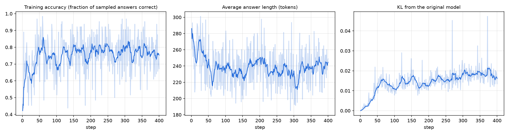

# GRPO from scratch on Qwen2.5-1.5B-Instruct

Reinforcement learning with verifiable rewards on GSM8K math word problems.
GRPO (Group Relative Policy Optimization) is implemented from scratch in
PyTorch in [`grpo.py`](grpo.py): group sampling, rule-based rewards,
group-relative advantages, and a KL-regularized policy-gradient loss, trained
with LoRA on a single A100.

**Result:** 400 GRPO steps (about 3 GPU-hours) raised GSM8K accuracy from
**68.2% to 73.6%** with no loss on MATH-500 or MMLU. Supervised fine-tuning on
the same training set *lowered* GSM8K to 51.9%.

## Results

| | Zero-shot | SFT (LoRA) | GRPO (LoRA, step 400) |
|---|---|---|---|
| GSM8K test accuracy (%) | 68.2 | 51.9 | **73.6** |
| MATH-500 accuracy (%) | 49.2 | 42.2 | 50.6 |
| MMLU, 500-question subset (%) | 57.0 | 56.6 | 57.2 |
| Avg. GSM8K answer length (tokens) | 281 | 85 | 253 |

All evaluations use greedy decoding and the same answer checkers
([`common.py`](common.py), tested in [`test_common.py`](test_common.py)).
MATH-500 and MMLU are not trained on; they check whether training on GSM8K
hurt other abilities.

GSM8K over the course of GRPO training:

| Checkpoint | Step 100 | Step 200 | Step 400 |
|---|---|---|---|
| GSM8K (%) | 71.5 | 72.3 | 73.6 |

The reported number is the final checkpoint, chosen before evaluation, not the
best of several.



## What I found

**GRPO improved in-domain accuracy without forgetting.** GSM8K rose 5.4
points (1,319 test questions, so about 4 standard errors) and kept improving
across checkpoints. MATH-500 (+1.4) and MMLU (+0.2) are within noise of
zero-shot: no measurable regression.

**SFT on the reference solutions made a strong model worse.** GSM8K's written
solutions are short, and SFT taught the model to copy that style: answers
shrank from 281 to 85 tokens and GSM8K accuracy fell 16 points. This happened
at both learning rates I tried. At lr 1e-4 SFT also caused forgetting
(MATH-500 24.2%, MMLU 50.4%); at lr 2e-5 (reported above) the forgetting
mostly disappeared but the in-domain drop did not. GRPO trains on the
model's own answers scored only for correctness, so it never has to imitate a
style that doesn't suit the model.

**Most of the learning happened early.** Training accuracy rose from about
45% to 75–80% in the first 50 steps and then plateaued. Training accuracy is
measured on samples at temperature 1.0, so part of that rise is the model
becoming more confident rather than more capable; the greedy test results
above are the real measure.

**The model stayed close to where it started.** KL from the original model
rose smoothly to about 0.015–0.02 and levelled off, and answers shortened
moderately (281 to 253 tokens) rather than collapsing.

## Method

Each step samples 8 answers for each of 8 GSM8K training questions. Rewards
are rule-based: 1.0 for a correct final answer, plus 0.1 for ending with
`#### <number>`. Each answer's advantage is its reward relative to the other
answers to the same question:

```
advantage = (reward - mean(group rewards)) / std(group rewards)
```

The loss is the policy gradient weighted by advantage, plus a per-token KL
penalty to the original model (the estimator from the DeepSeekMath paper),
averaged over each answer's tokens. The reference model is the base model with
the LoRA adapter switched off, so no second copy is held in memory.

| Setting | Value |
|---|---|
| Model | Qwen2.5-1.5B-Instruct, LoRA rank 16 on all attention and MLP projections |
| GRPO | 400 steps, 8 questions x 8 answers per step, temperature 1.0, up to 384 new tokens, lr 2e-5, KL weight 0.04, one update per batch |
| SFT baseline | 1 epoch on GSM8K train (7,473 examples), lr 2e-5, effective batch 16 |
| Hardware | One NVIDIA A100 40 GB (TAMU HPRC Grace); about 25 s per GRPO step |

## Reproduce

```bash
pip install torch transformers peft datasets accelerate math-verify matplotlib
python download.py
python eval.py --name zeroshot
python sft.py --lr 2e-5 --out runs/sft && python eval.py --adapter runs/sft --name sft
python grpo.py --steps 400 --out runs/grpo && python eval.py --adapter runs/grpo/step_400 --name grpo
python plot.py runs/grpo
```

## Files

- [`grpo.py`](grpo.py): the GRPO training loop
- [`sft.py`](sft.py): supervised fine-tuning baseline
- [`eval.py`](eval.py): evaluation on GSM8K, MATH-500 and MMLU
- [`common.py`](common.py): prompts, answer checkers, reward, data and model loading
- [`test_common.py`](test_common.py): tests for the answer checkers
- [`plot.py`](plot.py): training curves
- [`jobs/gpu.slurm`](jobs/gpu.slurm): Slurm job script
